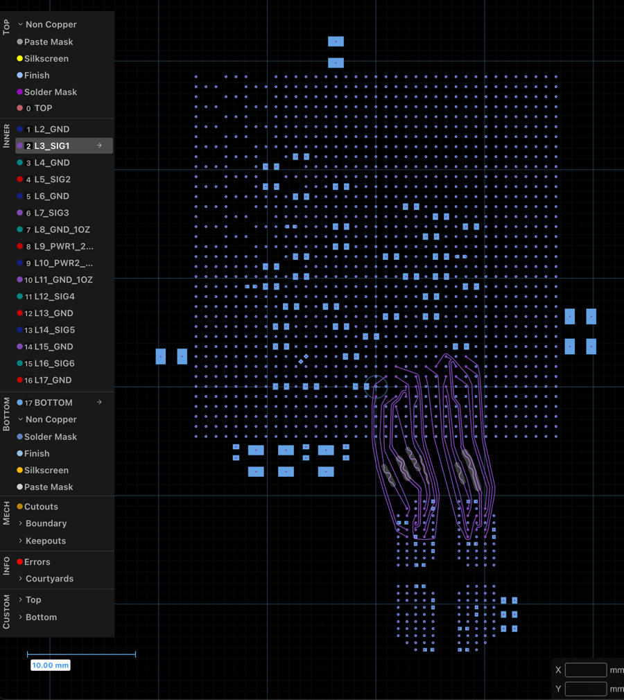

# JS4: FPGA to LPDDR4

**Shortcut:** Download the runbook for the part you want, give it to your AI coding agent, and tell
it to follow the file:

- {download}`Part 1 · Fanout and escape <part1-fanout-escape/JS4_Part1_Fanout-Escape_Runbook.md>`
- {download}`Part 2 · Power <part2-power/JS4_Part2_Power_Runbook.md>`
- {download}`Part 3 · SI constraints <part3-si-constraints/JS4_Part3_SI-Constraints_Runbook.md>`
- {download}`Part 4 · Routing <part4-routing/JS4_Part4_Routing_Runbook.md>`

Start a new agent session before you begin any part. Every step of a JS4 runbook drives a JITX
skill, and a skills install only takes effect in a session started after it.

JS4 lays out the link from the VP1002 FPGA from JS1 to a Micron MT53E1G32D2FW LPDDR4 memory, and
with it the JITX layout flow:

1. Layout in code. Parts 1 and 2 state a placement, via and power strategy once and code applies it
   to every ball, capacitor and rail it names: the fanout, the critical escapes, the decoupling and
   the power pours.
2. Constraints for layout and timing. Layout constraints set the copper: Part 1's narrower pair
   structure inside the ball fields, Part 2's widths and clearances for the heavy copper layers and
   Part 3's spacing between signal groups (Essentials: [Layout
   Constraints](https://docs.jitx.com/en/latest/essentials/physical_design/layout-constraints.html)).
   SI constraints set the timing and loss every signal must meet: Part 3 writes UG863's rules for
   LPDDR4 as constraints (Essentials: [Signal Integrity
   Constraints](https://docs.jitx.com/en/latest/essentials/SI/constraints.html)).
3. Interactive layout. Part 4 routes two byte lanes interactively, JITX's router matches their
   lengths, and the issues report measures every route against Part 3's SI constraints (Essentials:
   [Topological
   Autorouter](https://docs.jitx.com/en/latest/essentials/physical_design/autorouter.html)).

The board uses an 18-layer reference stackup that ships in `jitxexamples`, built from the
fabrication drawing of a production FPGA evaluation board. Every part assumes [JS0](../js0-setup/)
and [JS1 Part 2](../js1-stackup-components/part2-versal-fpga/) are done, because the design uses the
JS1 FPGA.

You can start at any part, since each starts from a reference design that ships in `jitxexamples`:
Part 1 from the connected board with only the FPGA placed, and each later part from the reference
of the part before it.

## The parts

### Part 1: Fanout and escape

In code, by driving `jitx-circuit-builder`, `jitx-code-layout` and `jitx-layout-constraints`: place
the memory below the FPGA, put a through via in the pad of every FPGA ball but its NC balls, and
every memory ball but NC and DNU, and ground pours on the ground layers, each part's vias in the
part's circuit, so they move when that circuit moves in code, and leave out of the decoupling the 27
capacitors that would connect to nothing on this board. Then escape channel B's two strobe
pairs, the ones Part 4 will route, out of both parts' ball fields in code, at the positions a
reference layout of those lanes gives, since that segment needs a tag and the interactive layout
requests cannot apply one. Written as code, the fanout is a via strategy stated once and
applied to every ball it names, so changing the strategy means changing the code and rebuilding, not
redrawing a ball field. Two `[HUMAN]` gates stop for you.
Everything for it is on the [Part 1 page](part1-fanout-escape/).

### Part 2: Power

In code, by driving `jitx-code-layout` and `jitx-layout-constraints`: width and clearance floors for
the two 2 oz power layers from a fabricator's published capability; the ZQ, IO_VR and RREF resistors
and the decoupling capacitors placed on the bottom side, each capacitor below 10 uF across two ball
vias of its rail and ground and the rest in a ring outside the ball field, each pad on its own via
and clear of the corridor Part 4's byte lanes take between the parts, every one of the 59 Part 1
keeps; and a pour for each of five rails on its
power layer, the 1.1 V one joining the FPGA's XPIO bank supplies to the memory. The placement rule,
the rail-to-layer map and the gap between rails are each stated once and applied to every capacitor
and pour they name, so the power layout is correct and consistent, and changing one is one edit and
a rebuild. The heavy copper rules are the general example of layout constraints: floors keyed on the
two 2 oz layers, and a trace width keyed on the rails' tag. Two `[HUMAN]` gates stop for you.
Everything for it is on the [Part 2 page](part2-power/).

### Part 3: SI constraints

Constraints that enforce signal integrity, whose skew limits JITX's router matches lengths against
when it routes a complex interface like LPDDR4 (Part 4 routes two byte lanes against them): UG863's
LPDDR4/4x timing as skews and delay limits, with four skews held to a layout target at 20% of
UG863's limit, package delay pin models, an insertion loss limit standing in for your SI team's
budget, and UG863's spacing as design rules with the under-device values on the strobe pairs'
segments inside the ball fields, by
driving `jitx-interconnect-constraints` and `jitx-layout-constraints`. It ends at the issues report
of the design before routing. One `[HUMAN]` gate stops for you. Everything for it is on the [Part 3
page](part3-si-constraints/).

### Part 4: Routing

Interactive routing of every DQ, DMI and DQS of channel B's two byte lanes on L3_SIG1, on Part 3's
reference, from the fanout vias and Part 1's strobe escapes to the memory, by driving
`jitx-interactive-layout`, the data lines untagged and control points only at the ends of
length-matching sections, with length matched by serpentines inside those sections and
JITX measuring Part 3's byte-lane limits on the routed copper: DQ and DMI to DQS skew, each DQS
pair's skew, and those nets' delay and loss, each limit one value in Part 3's code. Part 3's
command, address and clock limits stay unmeasured. One `[HUMAN]` gate stops for you. Everything for
it is on the [Part 4 page](part4-routing/).

Part 4's reference in the board editor, L3_SIG1 selected: the two byte lanes run from the FPGA's
ball field, top, to the memory's, bottom, with serpentines in their length-matching sections.

## Reference solutions

Verified code for each published part ships in the `jitxexamples` package, under
[`jitxexamples.jumpstart_kits.js4_fpga_lpddr4`](https://github.com/JITx-Inc/jitx-examples/tree/main/src/jitxexamples/jumpstart_kits/js4_fpga_lpddr4),
one module per part, named on that part's page.
