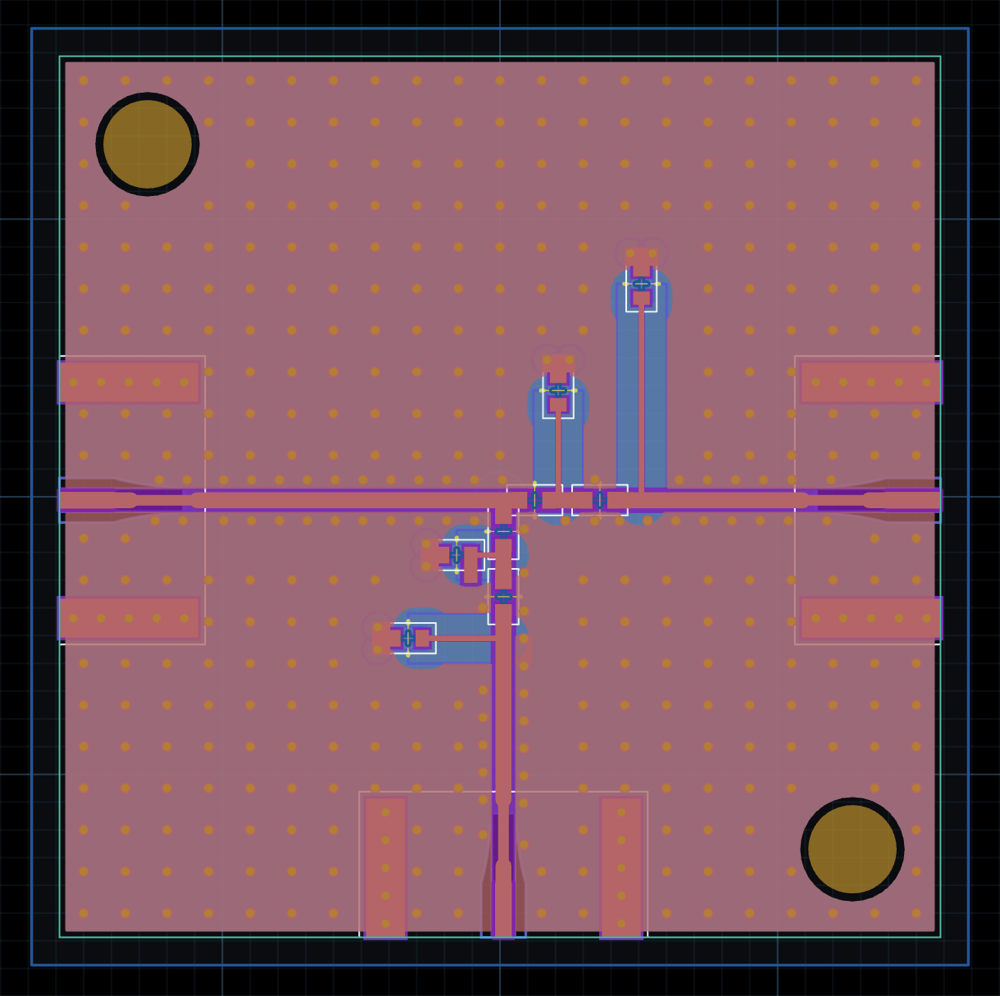

# JS5: Diplexer from Spec

**Shortcut:** {download}`Download the runbook <JS5_Diplexer-from-Spec_Runbook.md>`, save it beside
the vendor files it lists, give them to your AI coding agent, and tell it to follow the file.

Design a diplexer for 2.4 to 2.5 GHz and 5.1 to 5.9 GHz that beats the Mini-Circuits
ZDPLX-592-S+, by prompting an agent that drives the JITX HFSS optimization skill. The agent sizes
the filter from closed-form design, builds a 2-layer RO4350B board for JLCPCB in JITX, tunes the
SMA launch, then runs an HFSS campaign on the whole board. You approve the rough path and the
simulation setup, and set the budget.

What you learn is how to take an RF requirement to a fab-ready layout through a full-wave
optimization loop that the agent runs and you steer.

## What one run produced

One run, on earlier revisions of the runbook, produced the board below. Simulated at the SMA
connectors, it beats the ZDPLX on every specification but one: low-port isolation is 43.1 dB at
nominal against the ZDPLX's 45 dB typical. Worst-corner insertion loss is 0.33 dB under the ZDPLX
typical on the low port and 0.35 dB under it on the high port. The runbook sets some targets
tighter than the ZDPLX on purpose, to push the agent; the run met 12 of its 16 floors, and the
table compares with the ZDPLX itself.

| Metric | Band (GHz) | ZDPLX typical | Board, nominal | ZDPLX min or max | Board, worst corner |
|---|---|---|---|---|---|
| Insertion loss, low port | 2.4 to 2.5 | 0.8 dB | 0.42 dB | ≤ 1.2 dB | 0.47 dB |
| Insertion loss, high port | 5.1 to 5.9 | 0.9 dB | 0.52 dB | ≤ 1.7 dB | 0.55 dB |
| Return loss, low port | 2.4 to 2.5 | 16 dB | 21.8 dB | ≥ 10 dB | 18.0 dB |
| Return loss, high port | 5.1 to 5.9 | 12 dB | 19.0 dB | ≥ 8 dB | 17.4 dB |
| Return loss, common port | 2.4 to 2.5 | 16 dB | 22.8 dB | ≥ 10 dB | 18.8 dB |
| Return loss, common port | 5.1 to 5.9 | 12 dB | 18.8 dB | ≥ 8 dB | 17.1 dB |
| Stop-band isolation, low port | 5.1 to 5.9 | 45 dB | 43.1 dB | ≥ 38 dB | 41.2 dB |
| Stop-band isolation, high port | 2.4 to 2.5 | 40 dB | 45.5 dB | ≥ 35 dB | 41.7 dB |

Each metric's worst corner is set by the parts' tolerance and temperature drift. No board has been
fabricated yet; one will be. The scored board had its in-pad ground vias filled; the reference
solution leaves them open, since JLCPCB fills no via on RO4350B, a change not yet simulated.

## Before you start

- Finish [JS0](../js0-setup/).
- Get `jitxlib-ansys`, the JITX library that drives HFSS, and the JITX HFSS optimization plugin
  0.3.3 or later from JITX: neither is public. Install the plugin beside the JITX skills.
- Run the agent on a Linux machine with JITX 4.6, and Ansys Electronics Desktop 2026 R1 with an
  HFSS licence, with `ANSYSEM_ROOT` (the AEDT install root) and `ANSYSEM_ROOT261` set in the
  agent's shell.
- Download the vendor files the runbook lists, in a browser, and save them beside the runbook. The
  agent works from them and fetches nothing from the web.
- Start a new agent session. A skills install only takes effect in a session started after it.
- Allow two or more days on a 12-core machine, plus your time at the decisions below. The run
  above took about 16 hours of agent time over 49 hours from start to its final report. Rev 0.10
  has not been timed.
- To compare this run with your current flow afterward, note now roughly how long it takes your
  team to take a filter like this from a spec to a simulated layout, and what tends to go wrong.
  During the run, time it and note anything the checks caught.

## What the agent asks of you

Five `[HUMAN]` gates stop for you:

1. **Targets.** The agent shows you the sixteen floors as it will score them, and every choice the
   spec leaves open with a default for each. You answer.
2. **Rough path.** The agent shows you `rough-path.md`: each section's order, transmission zeros
   and starting values, checked at circuit level, with each floor's worst-corner penalty. You
   approve it or change it.
3. **Plan.** The agent shows you its plan for building the signed path. You approve it.
4. **Ready to simulate.** The agent shows you the simulation setup, what built each piece, each
   export's geometry and the board. You give the go.
5. **Principles and budget.** The agent shows you the operating principles for each section, the
   targets, what may change and what is pinned, and a budget in campaign rounds and launch
   calibration solves. You write the budget file yourself.

## After the run

You can now take an RF requirement through a full-wave optimization that the agent runs and you
steer, from a signed rough path to a scored final solve and a JLCPCB packet. Set the run's time
against your note, and anything the checks caught beside what tends to go wrong in your flow.
Building and measuring a board is outside this kit. A first run includes learning, so give the
agent a filter requirement of your own next and time it against the same note: that second run is
the fairer measure.

## Files

- [The runbook](JS5_Diplexer-from-Spec_Runbook.md), to read here;
  {download}`download it <JS5_Diplexer-from-Spec_Runbook.md>` to give to your agent.
- The vendor files listed under the runbook's prerequisites, which you download from Würth
  Elektronik, Kyocera AVX and Murata: the jack's HFSS model and data sheet, the Accu-P capacitors'
  S-parameters and data sheet, and the LQW15AN inductors' specification.
- The reference solution, module
  [`jitxexamples.jumpstart_kits.js5_diplexer`](https://github.com/JITx-Inc/jitx-examples/tree/main/src/jitxexamples/jumpstart_kits/js5_diplexer)
  in the `jitxexamples` package (`pip install jitxexamples`): the board without its HFSS setup,
  which needs `jitxlib-ansys`. Its `fab/` directory holds the fab notes and the JLCPCB packet.
